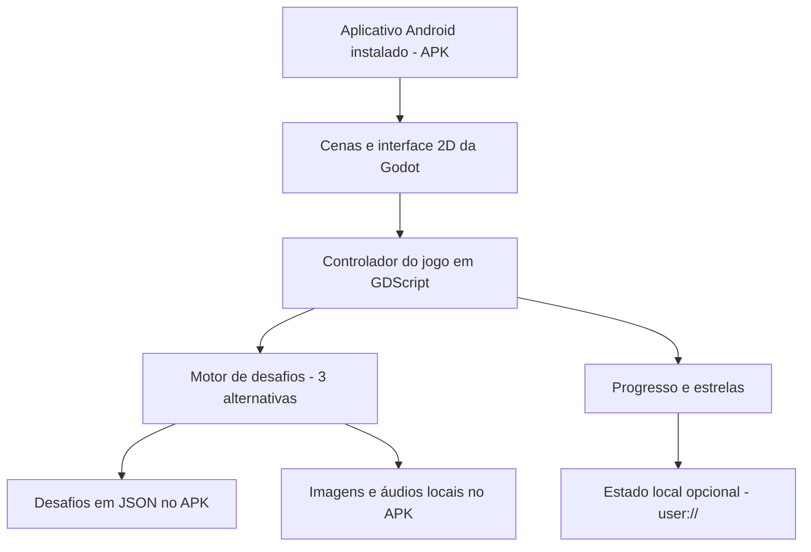
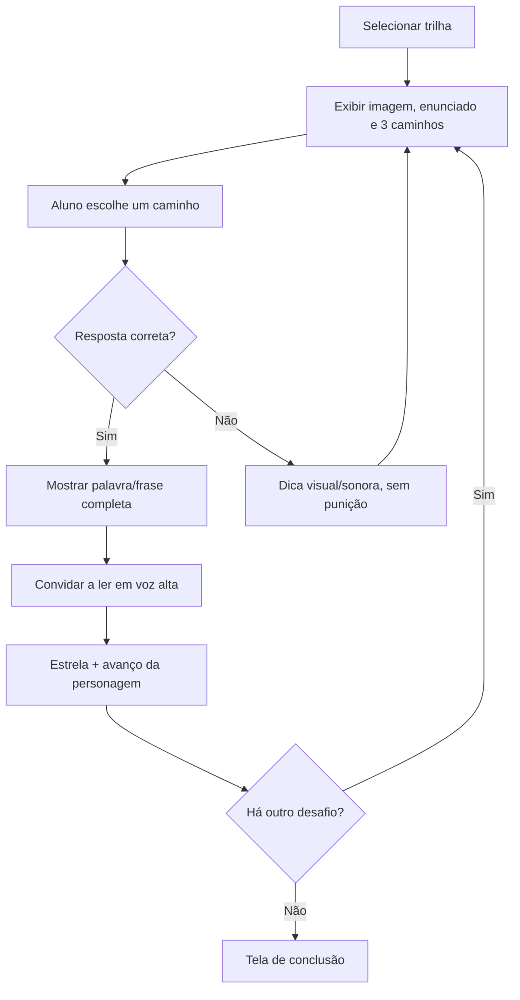

# Trilhas das Palavras — Proposta de abordagem e Solution Design (MVP)

**Disciplina:** Computação na Educação  
**Versão:** 0.2 — revisão da plataforma e do público-alvo, novembro de 2026  
**Público-alvo:** alunos de uma turma do **2º ano do Ensino Fundamental** de uma escola local, em diferentes estágios de alfabetização  
**Plataforma-alvo:** **aplicativo Android instalado localmente (APK)** em tablets com recursos de processamento limitados; funcionamento offline  
**Status:** proposta para validação com a professora; não é uma intervenção pedagógica já validada

> **Ideia central:** um jogo leve em que uma personagem percorre caminhos e resolve desafios de leitura e escrita. Em cada rodada, a criança escolhe entre três caminhos associados a letras, sílabas ou palavras. A resposta escolhida deve completar corretamente uma palavra ou frase apresentada em um contexto visual e/ou sonoro. O acerto permite avançar na história; o erro gera uma dica e uma nova tentativa, sem punição.

---

## 1. Contexto e problema

O projeto parte de necessidades relatadas pela professora responsável por uma **turma do 2º ano do Ensino Fundamental**, em conversa de 26/10/2026:

- Aproximadamente **60% dos alunos já leem pequenas frases**.
- **Quatro alunos ainda não leem pequenas palavras**; os demais conseguem ler e escrever palavras curtas, embora persistam algumas trocas na escrita.
- O trabalho atual envolve a **leitura e a escrita de frases de três ou quatro palavras**.
- A alfabetização começou com o **método fônico**, mas a professora utiliza estratégias variadas para atender diferentes formas e ritmos de aprendizagem.
- **Leitura em voz alta, atividades lúdicas e teatro** despertam interesse na turma.
- A escola já utiliza a plataforma **Anthon** em atividades digitais, inclusive fora da escola, e as crianças têm usuários para acesso nela.
- As atividades de educação digital costumam acontecer **em duplas, com um dispositivo por aluno**.

### 1.1 Problema identificado

Embora estejam no **2º ano do Ensino Fundamental**, os alunos apresentam níveis diferentes de apropriação do sistema de escrita alfabética. Uma atividade digital única, excessivamente simples, pode não desafiar quem já lê frases; uma atividade focada apenas em frases pode excluir alunos que ainda consolidam letras, sons e sílabas. Ao mesmo tempo, o recurso precisa oferecer interações intuitivas e executar adequadamente em tablets modestos.

**Questão orientadora:** como desenvolver um jogo digital leve, lúdico e acessível que apoie o reconhecimento de relações entre sons e letras, a formação de palavras e a leitura de pequenas frases, respeitando diferentes níveis de alfabetização e favorecendo a mediação docente?

### 1.2 Hipótese de projeto

Uma experiência curta, com desafios progressivos, feedback imediato e narrativa simples, **pode favorecer o engajamento e oferecer oportunidades de prática** de habilidades de alfabetização. Sua contribuição educacional deverá ser observada e avaliada na turma; a adoção de elementos presentes em jogos estudados não garante, por si só, melhora de aprendizagem.

---

## 2. Fundamentação e decisões derivadas da literatura

A proposta se inspira em pesquisas sobre aprendizagem da leitura mediada por jogos digitais, particularmente nas que abordam consciência fonológica e correspondências entre fonemas (sons) e grafemas (letras).

| Trabalho | Evidência ou contribuição | Decisão aplicada ao projeto |
|---|---|---|
| **Ramos e Prado (2020)** — revisão sistemática de 14 artigos sobre jogos digitais e consciência fonológica | A revisão identifica potencial de contribuição dos jogos para a alfabetização, especialmente quando trabalham intencionalmente consciência fonológica e instrução fônica. | Cada desafio terá uma habilidade linguística explícita, não apenas recompensas visuais. |
| **Marques de Souza, Weissheimer e Buchweitz (2022)** — estudo com *GraphoGame Brasil* | Estudo quase-experimental com resultados favoráveis em medidas relacionadas à precisão de leitura de palavras; nem todos os indicadores, como eficiência de leitura, melhoraram. | Trabalhar reconhecimento de sons/letras e leitura de palavras, sem pressupor que jogar melhora automaticamente fluência. |
| **Sucena, Silva e Viana (2016)** — intervenção com *Graphogame* em português europeu | Comparou intervenções com o software, intervenção mista e controle. Os grupos com intervenção tiveram resultados favoráveis; a combinação com orientação presencial apresentou efeito mais pronunciado. | O jogo será **complementar à atuação docente**, inclusive em atividades de leitura em voz alta. |
| **Santos et al. (2023, preprint)** — análise de usabilidade do *GraphoGame Brasil* | Identificou situações em que crianças precisaram da ajuda de adultos para navegar, devido a instruções visuais pouco claras. | Botões grandes, poucos elementos simultâneos, instruções faladas e tutorial curto. |
| **Wisintainer, Mota e Throssell (2026, preprint)** — estudo com *GraphoGame Brasil* em escolas públicas de Florianópolis | Investigou 51 crianças e relatou impacto positivo em nomeação de letras maiúsculas; é uma evidência preliminar e circunscrita aos resultados descritos. | Reforça a pertinência local de investigar recursos digitais, sem extrapolar o achado para todas as habilidades. |

**Síntese pedagógica:** o método fônico será uma **base**, e não a única abordagem. O jogo explicitará relações entre sons e representações escritas, mas também empregará imagens, contexto narrativo, leitura compartilhada e produção oral. **Selecionar sílabas não equivale, isoladamente, ao método fônico**: a ligação som–letra deve estar presente nas atividades e no áudio de apoio.

### 2.1 Alinhamento preliminar à BNCC

As atividades propostas dialogam com habilidades de Língua Portuguesa dos anos iniciais, especialmente:

- **EF01LP05:** reconhecer o sistema de escrita alfabética como representação dos sons da fala.
- **EF01LP06:** segmentar oralmente palavras em sílabas.
- **EF01LP07:** identificar fonemas e sua representação por letras.
- **EF01LP08:** relacionar elementos sonoros (sílabas, fonemas e partes de palavras) à representação escrita.
- **EF01LP12:** reconhecer a separação de palavras na escrita por espaços em branco.
- **EF12LP01:** ler palavras novas com precisão na decodificação e reconhecer palavras frequentes.

O alinhamento é **indicativo**: embora algumas habilidades citadas tenham código EF01 por serem aprendizagens fundamentais ainda em consolidação, o projeto é destinado ao **2º ano do Ensino Fundamental** e deve ser compatibilizado com os objetivos desse ano, o planejamento da professora e as dificuldades observadas. A escrita autônoma prevista na EF01LP02 poderá ser explorada em atividades complementares fora do jogo; escolher uma alternativa entre três não é equivalente a produzir escrita livre.

---

## 3. Objetivos

### 3.1 Objetivo geral

Desenvolver e avaliar inicialmente um protótipo de **aplicativo Android educativo, instalado e executado localmente**, leve e acessível, para apoiar atividades de alfabetização em língua portuguesa de uma **turma do 2º ano do Ensino Fundamental** por meio de desafios gamificados de relações som–letra, composição de palavras e leitura de frases curtas.

### 3.2 Objetivos específicos

1. Traduzir as necessidades relatadas pela professora em requisitos pedagógicos e técnicos.
2. Projetar uma mecânica única de três escolhas, reaproveitável para desafios em diferentes níveis.
3. Construir e distribuir um protótipo Android em APK que funcione em tablets modestos **sem depender de rede durante o uso**.
4. Inserir elementos lúdicos — personagem, caminhos, conquistas e narrativa breve — sem prejudicar a legibilidade.
5. Permitir que a professora escolha manualmente o nível apropriado para cada criança ou atividade.
6. Testar usabilidade, engajamento e realização dos desafios em uma aplicação-piloto acompanhada pela professora.

---

## 4. Proposta do jogo

### 4.1 Conceito

**Nome provisório:** *Trilhas das Palavras*.

Uma pequena personagem atravessa cenários ilustrados para encontrar um objetivo narrativo simples, como chegar à biblioteca, ajudar um animal ou completar uma missão. Para escolher o caminho correto, a criança resolve um desafio de linguagem. A história progride por telas curtas, com pouco texto e animações discretas.

**Duração sugerida:** sessões de aproximadamente **10 a 15 minutos**, ajustáveis pela professora do 2º ano.  
**Organização da sala:** jogo individual em cada tablet, com oportunidade de conversar e ler em voz alta com o colega ou a professora.  
**Tom da experiência:** colaborativo e acolhedor, sem ranking entre alunos, cronômetros ou perda de vidas.

### 4.2 Mecânica principal: três caminhos

1. A tela apresenta uma figura/cena, um desafio curto e, quando necessário, um botão para ouvir o enunciado.
2. A personagem encontra **três caminhos**, cada um com uma alternativa textual em destaque.
3. A criança toca o caminho correspondente à resposta correta.
4. O sistema verifica a escolha a partir do desafio cadastrado.
5. **Acerto:** destaca a solução, permite ouvir a palavra/frase completa, concede uma estrela e faz a personagem avançar.
6. **Erro:** informa de maneira positiva que vale tentar novamente, oferece pista sonora ou visual e mantém a criança na mesma rodada.
7. Ao concluir uma sequência curta, a criança recebe uma celebração discreta e pode reiniciar ou voltar ao menu.

**Regra essencial de autoria dos desafios:** a resposta precisa ser inequívoca. Se alternativas diferentes puderem formar palavras ou frases válidas, apresentar imagem, áudio ou contexto que identifique claramente a resposta desejada. Não marcar como erro uma alternativa linguisticamente possível em um enunciado ambíguo.

### 4.3 Três trilhas pedagógicas no MVP

A aplicação usará **a mesma interface e a mesma lógica de seleção**; o que muda é o conteúdo do desafio.

| Trilha | Perfil de atividade | Exemplo de desafio | Foco principal |
|---|---|---|---|
| **1 — Sons e letras** | Para crianças que ainda precisam consolidar relações som–grafia e unidades menores | Ouvir o som correspondente a **/m/** e escolher entre as letras **M**, **P** e **T** | Associação fonema–grafema, com áudio gravado e revisado pela professora |
| **2 — Montando palavras** | Para quem já reconhece letras/sílabas e lê palavras curtas | Uma ilustração de uma **casa**, áudio “casa” e a palavra **CA__**. Caminhos: **SA**, **MA**, **PO** | Composição, decodificação e leitura de palavras |
| **3 — Pequenas frases** | Para quem já lê pequenas palavras e inicia frases | Cena de um sapo pulando; frase **O SAPO ____**. Caminhos: **PULA**, **DORME**, **NADA** | Leitura e compreensão de frases de até 3–4 palavras |

Os nomes das trilhas não serão associados publicamente ao desempenho dos alunos. A professora poderá orientar a escolha sem que o jogo rotule uma criança como “atrasada” ou “avançada”. A **Trilha 3** responde diretamente ao estágio atual de parte expressiva da turma; as trilhas anteriores oferecem apoio aos demais.

### 4.4 Leitura em voz alta e dramatização

Ao finalizar cada desafio, o jogo pode exibir a palavra/frase completa e uma indicação simples: **“Agora leia em voz alta!”**. A criança lê para o colega ou a professora, ou interpreta uma fala da personagem.

Na primeira versão, essa leitura **não será capturada nem corrigida automaticamente**. A participação oral é uma atividade acompanhada em sala. Isso evita implementar reconhecimento de voz — complexo, sujeito a erros com fala infantil, dependente do dispositivo e potencialmente inadequado para tablets modestos — antes de validar a mecânica básica.

### 4.5 Gamificação sem sobrecarga

- **Recompensa:** uma estrela por desafio concluído, sem desconto por tentativas incorretas.
- **Progressão:** 4 ou 5 desafios para completar uma pequena etapa narrativa.
- **Feedback:** efeitos simples e positivos, acompanhados de texto/áudio opcional.
- **Narrativa:** personagem avança por caminhos e chega a um destino.
- **Sem competição obrigatória:** não há ranking, comparação pública, punição ou velocidade mínima.

As recompensas servem para comunicar progresso, não para substituir os objetivos de leitura.

---

## 5. Escopo da primeira versão (MVP)

### 5.1 Incluído

- Tela inicial e seleção manual entre três trilhas.
- Um cenário reutilizável com personagem e **três caminhos clicáveis**.
- Conjunto inicial de desafios previamente revisados com a professora (sugestão: **5 por trilha, 15 no total**).
- Exibição de letras, sílabas, palavras e frases com fonte legível.
- Ilustrações leves e áudios curtos previamente gravados para instruções e itens que exijam referência sonora.
- Validação de resposta, dica simples, nova tentativa e avanço.
- Estrelas, contagem de desafios concluídos e tela de encerramento.
- Reinício de sessão e funcionamento **100% offline desde a primeira abertura**, após instalação do APK com os recursos já incluídos.
- Interface adaptada ao tamanho e à orientação dos tablets Android disponíveis, testada diretamente nos aparelhos.

### 5.2 Fora do MVP (possíveis evoluções)

- Reconhecimento de fala, análise automática de pronúncia ou escrita manual.
- Inteligência artificial para geração de atividades.
- Adaptação automática de dificuldade por desempenho.
- Cadastro individual de alunos, sincronização em nuvem ou painel docente.
- Integração com contas ou dados da plataforma Anthon.
- Editor de fases para professores e biblioteca remota de conteúdo.
- Avatares complexos, mapas abertos, jogos competitivos ou múltiplos minijogos.

**Decisão de escopo:** entregar **uma mecânica bem executada**, com três variações de conteúdo, é mais útil para teste pedagógico do que distribuir o desenvolvimento entre vários modos incompletos.

---

## 6. Requisitos

### 6.1 Requisitos funcionais

| ID | Requisito | Prioridade |
|---|---|---|
| RF01 | Permitir iniciar uma sessão e selecionar uma das três trilhas. | Alta |
| RF02 | Mostrar um desafio com enunciado, três alternativas e apoio visual/sonoro quando aplicável. | Alta |
| RF03 | Associar cada alternativa a um caminho selecionável por toque. | Alta |
| RF04 | Validar a resposta correta definida no conteúdo da fase. | Alta |
| RF05 | Fornecer feedback imediato e dica após erro, permitindo tentar novamente. | Alta |
| RF06 | Atualizar o progresso e avançar a personagem após o acerto. | Alta |
| RF07 | Exibir a solução completa e incentivar leitura em voz alta. | Alta |
| RF08 | Exibir conclusão de etapa, estrelas e opção de jogar novamente. | Média |
| RF09 | Reproduzir instruções/sons mediante toque, com controle de som. | Alta |
| RF10 | Operar sem internet depois que o conteúdo necessário estiver armazenado no dispositivo. | Alta |

### 6.2 Requisitos não funcionais

| ID | Requisito | Critério/proposta inicial |
|---|---|---|
| RNF01 | Desempenho | Utilizar **Godot 2D** com cena simples e renderização compatível com o hardware; medir abertura, memória e resposta ao toque nos tablets reais. |
| RNF02 | Instalação e tamanho | Gerar um **APK Android** com as imagens, áudios e desafios incluídos. Comprimir recursos e medir o tamanho final do APK: a meta de **até 15 MB de assets próprios** não inclui o tamanho do motor do jogo. |
| RNF03 | Usabilidade infantil | Três opções por tela, áreas de toque grandes e espaçadas, textos curtos e instruções visuais/sonoras. |
| RNF04 | Acessibilidade | Alto contraste, não usar cor como único indicador, opção de repetir áudio, ausência de efeitos piscantes e pouca exigência de leitura nos menus. |
| RNF05 | Compatibilidade | Validar a **versão do Android, memória RAM, processador e suporte gráfico** dos tablets antes de fixar a versão e o renderizador da Godot. Não presumir compatibilidade sem teste. |
| RNF06 | Privacidade | No MVP, não coletar nomes, voz, fotos nem identificadores pessoais; sem publicidade, telemetria ou análises de terceiros. |
| RNF07 | Manutenção | Desafios separados da lógica do jogo em arquivo JSON local, revisável durante o desenvolvimento. |
| RNF08 | Confiabilidade | Repetir a fase após erro sem travamentos, duplicação de pontos ou avanço indevido. |
| RNF09 | Disponibilidade offline | Todos os recursos necessários já devem estar incluídos no APK, sem carregamento de páginas, serviços online ou cache inicial. |

Os limites de tamanho e desempenho são **metas de projeto**, não resultados medidos. Caso os dispositivos não executem a Godot com desempenho satisfatório, será avaliada uma implementação Android nativa mais simples (por exemplo, Kotlin), mantendo a mesma proposta pedagógica.

---

## 7. Solution Design técnico

### 7.1 Abordagem de implementação

**Proposta revisada:** desenvolvimento de um **aplicativo Android local**, distribuído por **APK**, usando **Godot Engine (projeto 2D) e GDScript**, **sem servidor, navegador ou conexão com a internet no MVP**.

**Justificativa:** a interação central é de um jogo 2D: personagem, caminhos, transições, feedback visual e reprodução de sons. A Godot oferece uma estrutura apropriada para cenas e animações simples, com exportação para Android. É importante ressaltar que **ser nativo/instalado não garante menor consumo de memória do que uma aplicação web**; a decisão será validada com um protótipo nos tablets reais. A prioridade é manter poucas cenas ativas, imagens compactas e efeitos discretos.

**Componentes previstos:**

- **Godot 2D (GDScript):** telas, eventos de toque, estado do jogo e lógica dos desafios.
- **Cenas reutilizáveis:** menu, seleção da trilha, fase com três caminhos, feedback e encerramento.
- **JSON empacotado:** catálogo de desafios, alternativas, respostas e referências de mídia.
- **Imagens e áudios locais:** ilustrações otimizadas e falas curtas pré-gravadas; nenhuma requisição de rede.
- **`user://` (opcional):** armazenamento local, no dispositivo, de progresso sem identificação de aluno. O MVP pode simplesmente reiniciar a sessão ao abrir.
- **Exportação Android:** geração de APK para instalação nos equipamentos da escola; distribuição e permissões de instalação devem ser combinadas com a instituição.

**Decisão condicionada ao hardware:** escolher a versão da Godot e o renderizador (preferencialmente **Compatibility**, se suportado) depois de identificar versão do Android, RAM e recursos gráficos dos tablets. Se o motor não apresentar desempenho ou compatibilidade aceitáveis, usar interface Android nativa com Kotlin e renderização 2D simples como alternativa. A prioridade é **testar antes de consolidar a stack**, não assumir ganho de desempenho apenas pela instalação local.

### 7.2 Arquitetura lógica



**Responsabilidades:**

1. **Interface 2D:** mostra enunciado, cenário, alternativas, personagem e feedback, recebendo os toques.
2. **Controlador:** gerencia os estados `menu`, `desafio`, `acerto`, `dica` e `fim`.
3. **Motor de desafios:** carrega um registro JSON, apresenta três escolhas e compara a seleção com a resposta esperada.
4. **Conteúdo:** define objetivo pedagógico e mídia de cada atividade sem alterar a lógica do jogo.
5. **Áudio:** reproduz arquivos locais; não depende de serviços online nem de reconhecimento automático de voz.
6. **Persistência (opcional):** armazena somente progresso não identificado em arquivo local do aplicativo.

### 7.3 Organização inicial de arquivos

```text
trilhas-das-palavras/
├── project.godot
├── scenes/
│   ├── menu.tscn              # tela inicial
│   ├── trilhas.tscn           # seleção da trilha
│   ├── desafio.tscn           # cenário e três caminhos
│   └── conclusao.tscn        # encerramento
├── scripts/
│   ├── game.gd                # estados, avanço, estrelas
│   ├── challenge_loader.gd    # catálogo e validação
│   └── audio_manager.gd       # reprodução de sons
├── data/
│   └── desafios.json          # questões locais
└── assets/
    ├── imagens/               # imagens 2D otimizadas
    └── audio/                 # gravações comprimidas e curtas
```

O **APK exportado** deve conter as cenas, scripts, catálogo, imagens e sons usados no MVP, de modo que a experiência esteja disponível imediatamente após a instalação. A estrutura é sugestão inicial, não uma obrigação arquitetural.

### 7.4 Modelo mínimo de um desafio

Exemplo ilustrativo para a trilha de palavras:

```json
{
  "id": "palavras-01",
  "trilha": "palavras",
  "habilidade": "completar_palavra_com_silaba",
  "enunciado": "Complete o nome da figura",
  "texto": "CA__",
  "imagem": "res://assets/imagens/casa.webp",
  "audioEnunciado": "res://assets/audio/casa.ogg",
  "alternativas": [
    { "id": "a", "texto": "SA" },
    { "id": "b", "texto": "MA" },
    { "id": "c", "texto": "PO" }
  ],
  "respostaCorreta": "a",
  "textoCompleto": "CASA",
  "audioSolucao": "res://assets/audio/casa.ogg",
  "dica": "Ouça novamente e observe a figura."
}
```

A opção **MA** também formaria uma palavra existente (*CAMA*), mas **a imagem e o áudio especificam CASA**, de modo que a pergunta não dependa apenas de adivinhar uma combinação válida. Em outros desafios, as alternativas devem passar pela mesma revisão pedagógica. Os arquivos em `res://` são recursos incluídos no projeto e distribuídos com o aplicativo.

### 7.5 Fluxo de uma rodada



**Regras de implementação:** bloquear toques adicionais durante uma transição curta; somar estrela uma única vez por desafio; embaralhar, quando desejável, **somente as posições** das opções sem modificar o identificador correto; oferecer botão para repetir o áudio.

### 7.6 Estratégia para execução leve

- Construir o jogo em **2D**, sem física complexa, simulações ou mapas grandes.
- Reutilizar **uma única cena de desafio** e trocar apenas texto, alternativas, imagem e áudio conforme o JSON.
- Manter um **cenário estático**; animar somente o personagem ou um destaque, usando animações simples.
- Evitar partículas, shaders pesados, vídeos, texturas de alta resolução e carregamento simultâneo de muitas mídias.
- Preferir ilustrações 2D compactas e áudio curto pré-gravado, com formatos suportados pela versão da Godot adotada.
- Carregar somente os arquivos necessários para a fase atual e reutilizar recursos já carregados.
- Ajustar o layout ao tamanho da tela e testar orientação horizontal ou vertical nos dispositivos reais.
- Manter opção de reduzir ou desativar animações e efeitos sonoros.
- Executar testes **em modo avião desde a primeira abertura após instalar o APK** e verificar inicialização, fluidez, memória e resposta aos toques.

---

## 8. Design de interface e experiência

### 8.1 Telas previstas

**Tela 1 — Início:** título, personagem, botão grande **JOGAR** e ícone para áudio de instrução.

**Tela 2 — Escolha da trilha:** três cartões com ícones e nomes curtos (**Sons e Letras**, **Palavras**, **Frases**); a professora orienta a escolha.

**Tela 3 — Desafio:** figura principal e/ou situação narrativa na parte superior; palavra/frase em fonte grande; três caminhos largos na parte inferior; botão de repetir áudio sempre visível.

**Tela 4 — Feedback:** em caso de acerto, apresenta a resposta e faz a personagem avançar; em caso de erro, mostra uma dica e permite nova tentativa sem trocar a pergunta.

**Tela 5 — Encerramento:** estrelas da etapa e botões **JOGAR NOVAMENTE** e **INÍCIO**.

### 8.2 Princípios de interação

- Uma ação principal por vez e **três alternativas**, nunca menus com muitas escolhas simultâneas.
- Texto em tamanho confortável e contraste alto; considerar letras maiúsculas nas primeiras atividades conforme a prática da turma, sem tornar isso uma regra universal.
- A alternativa aparece com **texto**, não só com ícone, e é clicável em toda a superfície do caminho.
- A instrução não depende exclusivamente de leitura: usar demonstração curta e botão de áudio.
- O feedback distingue **tentativa incorreta** de falha pessoal: “Vamos ouvir de novo?” em vez de “Você perdeu!”.
- O elemento narrativo deve apoiar a tarefa, não disputar a atenção com a palavra/frase.

---

## 9. Conteúdo pedagógico e revisão

### 9.1 Preparação do catálogo

Antes do desenvolvimento final do conteúdo, validar com a professora:

1. Quais correspondências letra–som e sílabas já foram trabalhadas na turma.
2. Quais trocas de letras/sílabas são mais recorrentes e adequadas para desafios.
3. Quais palavras são familiares às crianças e possuem imagens inequívocas.
4. Quais frases curtas (até três ou quatro palavras) fazem sentido para o estágio atual.
5. Como e quando incluir leitura oral entre desafios, sem interromper demais o fluxo da aula.

A progressão deve ser orientada pelo **conteúdo efetivamente ensinado**, não apenas pelo comprimento das palavras. Evitar, inicialmente, correspondências ortográficas mais ambíguas sem explicação prévia. Todos os textos, áudios e distratores devem ser conferidos antes de serem incorporados ao jogo.

### 9.2 Critérios de qualidade de cada atividade

- Tem um objetivo pedagógico definido e compreensível.
- Usa linguagem natural do português brasileiro.
- Possui apenas **uma resposta compatível** com o enunciado, a imagem e o áudio.
- Usa distratores úteis para o aprendizado, mas não enganosos.
- Pode ser resolvida por uma criança da trilha selecionada com apoio previsto.
- Oferece feedback e possibilidade de nova tentativa.

---

## 10. Plano simples de desenvolvimento e validação

### 10.1 Etapas sugeridas

| Etapa | Entrega | Verificação |
|---|---|---|
| **1. Alinhamento** | Revisão da proposta com a professora e escolha dos conteúdos iniciais | Aprovação das habilidades e exemplos |
| **2. Protótipo de interface** | Uma tela funcional com três caminhos e uma questão | Toque, legibilidade e entendimento do desafio |
| **3. Mecânica completa** | Escolha, resposta, dica, avanço e estrelas | Fluxo funcional sem pontuação duplicada |
| **4. Conteúdo** | 15 questões, distribuídas nas três trilhas | Revisão linguística e pedagógica pela professora |
| **5. Otimização e empacotamento** | Recursos comprimidos e APK Android gerado | Instalação e teste em tablets reais, inclusive sem conexão |
| **6. Piloto** | Sessão acompanhada na escola | Registro simples de uso e ajustes prioritários |

### 10.2 Avaliação piloto

A avaliação inicial deve ser **formativa**, para verificar a adequação do protótipo à turma, sem fazer inferências causais de eficácia a partir de uma única aplicação.

**Indicadores possíveis:**

- **Usabilidade:** a criança identifica onde tocar? Precisa de ajuda para iniciar, ouvir ou responder?
- **Execução:** o APK instala, o jogo abre, responde a toques e funciona sem internet desde a primeira abertura?
- **Engajamento:** a criança aceita jogar, conclui a sequência e demonstra interesse em continuar?
- **Interação pedagógica:** participa da leitura em voz alta? Utiliza pistas sonoras/visuais? Consegue explicar alguma escolha?
- **Dificuldade:** número de tentativas por desafio, com interpretação cuidadosa (erros podem indicar dificuldade com o item, ambiguidade ou problema de interface).

**Instrumento:** checklist curto preenchido pela professora/observador por sessão, com notas anônimas sobre dificuldades e sugestões. Se houver avaliação de aprendizagem, pode-se aplicar uma pequena atividade de leitura análoga antes e depois de algumas sessões, **com orientação docente e sem atribuir mudanças exclusivamente ao software**.

### 10.3 Critérios de aceite do MVP

- [ ] É possível concluir uma rodada inteira sem instrução textual longa.
- [ ] As três trilhas carregam desafios válidos no mesmo mecanismo.
- [ ] Toda escolha correta promove avanço exatamente uma vez.
- [ ] Toda escolha incorreta oferece dica e permite tentar novamente.
- [ ] A atividade de palavras possui referência visual/sonora que elimina ambiguidades.
- [ ] O APK é instalável nos tablets de teste e o jogo funciona em modo avião **desde a primeira abertura**, com todos os recursos incluídos.
- [ ] O jogo não solicita cadastro nem captura dados pessoais ou áudio da criança.
- [ ] A professora consegue avaliar se os desafios correspondem ao planejamento da turma.
- [ ] Os textos e os botões são legíveis e tocáveis nos dispositivos disponíveis.

---

## 11. Riscos e limitações

| Risco | Consequência | Mitigação inicial |
|---|---|---|
| Diferença de alfabetização dentro da turma | Alguns desafios podem ficar fáceis ou difíceis demais | Três trilhas escolhidas com mediação docente |
| Questão ambígua ou distrator inadequado | Criança recebe feedback incorreto | Revisão de todas as imagens, palavras, áudios e respostas |
| Excesso de animações e efeitos | Lentidão e perda de foco | Cenário estático e transições mínimas |
| Android ou renderização gráfica incompatível com a versão da Godot | O APK não instala, não abre ou apresenta lentidão | Levantar especificações dos tablets, exportar protótipo mínimo e, se necessário, considerar Kotlin nativo |
| Interface pouco intuitiva | Crianças precisam de ajuda constante | Tutorial demonstrativo e sessão piloto curta |
| Redução do método fônico a caça-sílabas | Baixa coerência pedagógica | Trabalhar explicitamente sons/letras e leitura oral, não apenas combinações visuais |
| Confundir engajamento com aprendizagem | Conclusões educacionais indevidas | Separar métricas de uso da avaliação de habilidades de leitura |
| Uso de dados de menores | Risco de privacidade | MVP sem contas, identificadores ou gravações |

---

## 12. Evoluções possíveis após validar o MVP

Estas ideias ficam **deliberadamente fora** da primeira entrega:

1. **Múltiplos formatos de interação:** arrastar letras, formar frases e narrativas dialogadas.
2. **Ajuste de dificuldade:** sugestão de trilha com base em desempenho, sempre sob controle docente.
3. **Painel da professora:** seleção de conteúdos e acompanhamento de dificuldades, com análise de privacidade.
4. **Modo de dramatização:** mais falas de personagens e atividades orais mediadas.
5. **Editor de desafios:** criação e revisão de conteúdo pela escola.
6. **Sincronização opcional:** continuidade entre casa e escola, caso haja necessidade real, autorização institucional e infraestrutura compatível.

A plataforma Anthon é um **referencial de prática digital já existente na escola**; integração com ela não é requisito, nem pressuposta como tecnicamente disponível.

---

## 13. Resultado esperado

Ao término desta primeira fase, espera-se ter um **protótipo Android (APK) instalável e funcional**, destinado a uma **turma do 2º ano do Ensino Fundamental**, com um cenário, uma mecânica de três caminhos, três trilhas de conteúdo, feedback, progressão simples e execução **inteiramente offline** nos dispositivos validados. O produto deve permitir à professora experimentar atividades coerentes com os níveis distintos de alfabetização da turma e fornecer evidências iniciais de usabilidade e adequação pedagógica.

A contribuição do projeto será tanto **computacional** — concepção de um aplicativo Android 2D leve, modular e orientado a dados — quanto **educacional** — tradução de necessidades concretas da escola em desafios de leitura com mediação docente. A eficácia na aprendizagem permanece uma **questão empírica a investigar**, não uma promessa do software.

---

## Referências e materiais de apoio

**[R1]** RAMOS, Daniela Karine; PRADO, Luciana Augusta Ribeiro do. **Os jogos digitais para o desenvolvimento da consciência fonológica na alfabetização: uma revisão sistemática de literatura**. *Revista Educação e Linguagens*, 2020. DOI: [10.33871/22386084.2020.9.17.433-452](https://doi.org/10.33871/22386084.2020.9.17.433-452).

**[R2]** MARQUES DE SOUZA, Juliana G.; WEISSHEIMER, Janaina; BUCHWEITZ, Augusto. **Well Played! Promoting Phonemic Awareness Training Using EdTech—GraphoGame Brazil—During the COVID-19 Pandemic**. *Brain Sciences*, v. 12, n. 11, art. 1494, 2022. DOI: [10.3390/brainsci12111494](https://doi.org/10.3390/brainsci12111494).

**[R3]** SUCENA, Ana; SILVA, Ana Filipa; VIANA, Fernanda Leopoldina. **Intervenção precoce nas dificuldades de aprendizagem da leitura com recurso ao software Graphogame**. *Letrônica*, 2016. DOI: [10.15448/1984-4301.2016.2.23812](https://doi.org/10.15448/1984-4301.2016.2.23812).

**[R4]** SANTOS, Adriana Cavalcanti dos; ALVES, Amanda Loyse da Silva; ARAÚJO, Elisane Barbosa de; SANTOS, Nádson Araújo dos. **Gamificação na alfabetização: usabilidade e leitura no app GraphoGame Brasil**. *SciELO Preprints*, 2023. **Preprint**. DOI: [10.1590/SciELOPreprints.5304](https://doi.org/10.1590/SciELOPreprints.5304).

**[R5]** WISINTAINER, Danielle dos Santos; MOTA, Mailce Borges; THROSSELL, Michelle. **O uso de tecnologias educacionais para o desenvolvimento da consciência fonológica em português brasileiro: um experimento com o GraphoGame Brasil**. *SciELO Preprints*, 2026. **Preprint**. DOI: [10.1590/SciELOPreprints.15735](https://doi.org/10.1590/SciELOPreprints.15735).

**[R6]** BRASIL. Ministério da Educação. **Base Nacional Comum Curricular (BNCC)**. 2018. [Documento oficial](https://www.gov.br/mec/pt-br/escola-em-tempo-integral/BNCC_EI_EF_110518_versaofinal.pdf), seção de Língua Portuguesa dos anos iniciais, especialmente pp. 99–101.

**[R7]** BRASIL. Ministério da Educação. **GraphoGame — apresentação do aplicativo**. [Portal de alfabetização do MEC](https://alfabetizacao.mec.gov.br/grapho-game). Material de referência sobre o produto, **não** substitui evidências acadêmicas de eficácia.

### Observação metodológica sobre as fontes

As referências [R1]–[R3] incluem revisão e estudos publicados; [R4]–[R5] são **preprints**, portanto devem ser citadas com essa ressalva. Os resultados relatados pertencem aos jogos e aos contextos estudados, não ao protótipo aqui proposto. Os dados de caracterização da turma provêm exclusivamente do relato da professora de 26/10/2026 e ainda deverão ser confirmados para a aplicação do projeto.
